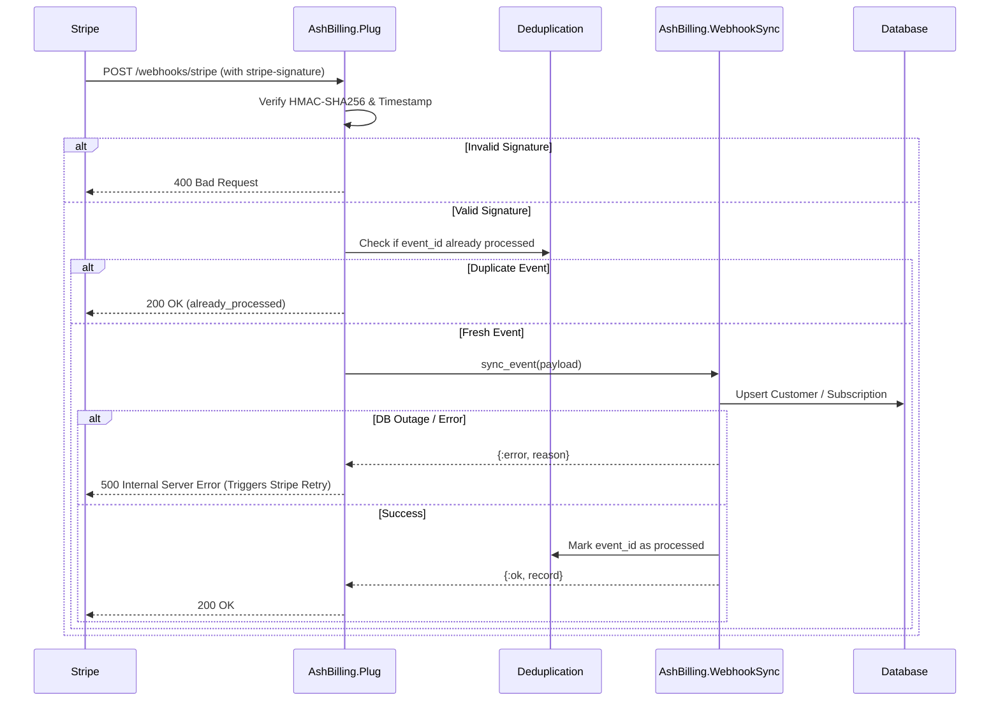

# Webhooks, Deduplication & Operational Resilience

Billing webhooks carry real financial state: invoice payments, subscription expirations, trial conversions, and plan changes. An improperly handled webhook can lock legitimate users out or give unauthorized access to non-paying accounts.

`AshBilling` implements a multi-layer defense architecture to ensure zero silent failures, strict idempotency, and high resilience.

---

## 1. Webhook Lifecycle & Signature Verification

Stripe sends webhook payloads signed with a shared secret (`whsec_...`).

When a request arrives at `AshBilling.Plug`:

1. **Header Extraction**: The `stripe-signature` header is parsed for the timestamp (`t=...`) and the HMAC signature (`v1=...`).
2. **Tolerance Window**: Signatures older than 300 seconds are rejected to prevent replay attacks.
3. **Constant-Time Verification**: The signature is recalculated using `:crypto.mac(:hmac, :sha256, secret, "#{timestamp}.#{raw_body}")` and compared using `:crypto.hash_equals/2` to protect against timing attacks.



---

## 2. The HTTP 500 Retry Protocol

### Why Returning 200 on Database Failure is Dangerous

If your database experiences a brief connection spike or lock timeout during webhook processing, returning `HTTP 200` signals to Stripe that the event was processed successfully. Stripe will **never retry** that event, leaving your local database permanently out of sync with real billing state.

### The AshBilling Solution

When database synchronization fails:
- `AshBilling.Plug` responds with **HTTP 500 Internal Server Error**.
- The event is **NOT** marked as processed in the deduplication store.
- Stripe automatically triggers its built-in exponential backoff retry policy (retrying for up to 72 hours).
- When your database recovers, Stripe's retry succeeds and updates your local records.

---

## 3. Deduplication Strategies

Stripe guarantees *at-least-once* delivery, meaning the same webhook event can arrive multiple times. `AshBilling` provides two deduplication backends:

### 3.1 In-Memory ETS (`:memory`, default)

Maintains an ETS table with automatic 24-hour TTL expiration.
- **Best for**: Single-server deployments, staging environments, and local development.
- **Zero configuration**: Starts automatically with your application supervision tree.

### 3.2 Database-Backed Resource (`:resource`)

Guarantees cluster-wide deduplication across multiple server nodes (e.g. Fly.io, Kubernetes, AWS ECS, Render).

Define a dedicated resource:

```elixir
defmodule MyApp.Billing.WebhookEvent do
  use Ash.Resource,
    domain: MyApp.Billing,
    data_layer: AshPostgres.DataLayer,
    extensions: [AshBilling.WebhookEvent]
end
```

Then configure it in your router options:

```elixir
forward "/stripe", AshBilling.Plug,
  customer_resource: MyApp.Accounts.User,
  subscription_resource: MyApp.Billing.Subscription,
  deduplication_resource: MyApp.Billing.WebhookEvent
```

---

## 4. Polymorphic Payload Tolerance

Stripe APIs evolve over time, and webhooks may contain string identifiers (`"cus_123"`) or fully expanded object maps (`%{"id" => "cus_123", "email" => ...}`).

`AshBilling.WebhookSync` uses schema-tolerant extractors:
- **Customer resolution**: Automatically extracts the customer ID whether it is a string or an expanded map.
- **Price resolution**: Resolves price IDs across multiple schema variants: `items.data[0].price.id`, `items.data[0].plan.id`, or top-level `plan.id`.
- **Safe Timestamps**: Uses `DateTime.from_unix/2` with safe pattern-matching fallbacks, preventing unexpected crashes if timestamps are missing or malformed.

---

## 5. Telemetry and Production Monitoring

`AshBilling` emits standard `:telemetry` events with execution durations and metadata:

```elixir
# Example: Log failed webhooks to AppSignal or Sentry
:telemetry.attach(
  "my-app-billing-alerts",
  [:ash_billing, :sync, :exception],
  fn _event_name, measurements, metadata, _config ->
    Logger.error("Billing sync failed: #{inspect(metadata.reason)}",
      duration: measurements.duration,
      event_type: metadata.event_type,
      event_id: metadata.event_id
    )
  end,
  nil
)
```
