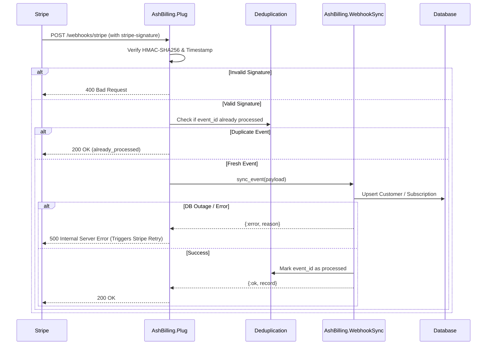

# Webhooks, Deduplication & Operational Resilience

Billing webhooks carry real financial state: invoice payments, subscription expirations, trial conversions, and plan changes. An improperly handled webhook can lock legitimate users out or give unauthorized access to non-paying accounts.

`AshBilling` provides signature verification, event leases, conditional subscription updates and retry handling. Persistent deduplication and database constraints must be configured for the application's deployment scope.

---

## 1. Webhook Lifecycle & Signature Verification

Stripe sends webhook payloads signed with a shared secret (`whsec_...`).

When a request arrives at `AshBilling.Plug`:

1. **Header Extraction**: The `stripe-signature` header is parsed for the timestamp (`t=...`) and the HMAC signature (`v1=...`).
2. **Tolerance Window**: Signatures older than 300 seconds are rejected to prevent replay attacks.
3. **Constant-Time Verification**: The signature is recalculated using `:crypto.mac(:hmac, :sha256, secret, "#{timestamp}.#{raw_body}")` and compared using `:crypto.hash_equals/2` to protect against timing attacks.



---

## 2. The HTTP 500 Retry Protocol

### Why Returning 200 on Database Failure is Dangerous

If your database experiences a brief connection spike or lock timeout during webhook processing, returning `HTTP 200` signals to Stripe that the event was processed successfully. Stripe will **never retry** that event, leaving your local database permanently out of sync with real billing state.

### The AshBilling Solution

When database synchronization fails:
- `AshBilling.Plug` responds with **HTTP 500 Internal Server Error**.
- The event is **NOT** marked as processed in the deduplication store.
- Stripe automatically triggers its built-in exponential backoff retry policy (retrying for up to 72 hours).
- When your database recovers, Stripe's retry succeeds and updates your local records.

---

## 3. Deduplication Strategies

Stripe guarantees *at-least-once* delivery, meaning the same webhook event can arrive multiple times. `AshBilling` provides two deduplication backends:

### 3.1 In-Memory ETS (`:memory`, default)

Maintains an ETS table with automatic 24-hour TTL expiration.
- **Best for**: Single-server deployments, staging environments, and local development.
- **Zero configuration**: Starts automatically with your application supervision tree.

### 3.2 Database-Backed Resource (`:resource`)

Guarantees cluster-wide deduplication across multiple server nodes (e.g. Fly.io, Kubernetes, AWS ECS, Render).

Define a dedicated resource:

```elixir
defmodule MyApp.Billing.WebhookEvent do
  use Ash.Resource,
    domain: MyApp.Billing,
    data_layer: AshPostgres.DataLayer,
    extensions: [AshBilling.WebhookEvent]

  postgres do
    table "webhook_events"
    repo MyApp.Repo
  end

  actions do
    default_accept :*
    defaults [:read, :create, :update, :destroy]
  end
end
```

Then configure it in your router options:

```elixir
forward "/stripe", AshBilling.Plug,
  webhook_secret: {System, :get_env, ["STRIPE_WEBHOOK_SECRET"]},
  customer_resource: MyApp.Accounts.User,
  subscription_resource: MyApp.Billing.Subscription,
  deduplication_resource: MyApp.Billing.WebhookEvent
```

---

## 4. Polymorphic Payload Tolerance

Stripe APIs evolve over time, and webhooks may contain string identifiers (`"cus_123"`) or fully expanded object maps (`%{"id" => "cus_123", "email" => ...}`).

`AshBilling.WebhookSync` uses schema-tolerant extractors:
- **Customer resolution**: Automatically extracts the customer ID whether it is a string or an expanded map.
- **Price resolution**: Resolves price IDs across multiple schema variants: `items.data[0].price.id`, `items.data[0].plan.id`, or top-level `plan.id`.
- **Safe Timestamps**: Uses `DateTime.from_unix/2` with safe pattern-matching fallbacks, preventing unexpected crashes if timestamps are missing or malformed.

---

## 5. Telemetry and Production Monitoring

`AshBilling` emits standard `:telemetry` events with execution durations and metadata:

```elixir
# Example: Log failed webhooks to AppSignal or Sentry
:telemetry.attach(
  "my-app-billing-alerts",
  [:ash_billing, :sync, :exception],
  fn _event_name, measurements, metadata, _config ->
    Logger.error("Billing sync failed: #{inspect(metadata.reason)}",
      duration: measurements.duration,
      event_type: metadata.event_type,
      event_id: metadata.event_id
    )
  end,
  nil
)
```

## Concurrent subscription updates

Customer and subscription resources must expose a primary update action that supports
atomic updates. Custom action names are supported. Missing actions or unsupported atomic
updates return errors; synchronization never falls back to an unguarded write.

Subscription updates compare the persisted status at commit time with the status read
by the worker. A pending nonterminal update cannot overwrite a terminal status committed
while a provider request was in flight, including events with equal timestamps. Older
event timestamps are also rejected. A conflicting nonterminal status change returns
`{:error, :subscription_changed_concurrently}` so the webhook can be retried.

For Stripe, `canceled` and `incomplete_expired` are terminal for the same subscription ID.
A new subscription uses a new ID; resuming a scheduled cancellation before it becomes
terminal remains supported. Custom providers can transition a terminal state that the
worker actually read, subject to the same timestamp and atomic concurrency guards.

## Customer identity and recovery

A persisted customer ID is authoritative. Initial association is allowed only when the
local customer has no provider ID and the event supplies its local ID in trusted
`metadata.resource_id` or `client_reference_id`. Conflicting references are rejected.
The initial write is conditional on the provider ID still being empty, so competing
customers cannot claim the same user. Email alone cannot establish ownership.

Contradictions return `:customer_identity_conflict` or `:subscription_customer_conflict`;
unresolved owners return `:customer_not_found` or `:customer_identity_unverified`.
The Plug returns HTTP 500 and releases the event lease by default. These events are
not permanently discarded: repair the association or configuration and retry the same
event. Applications must generate local references on the server and must not accept
arbitrary ownership metadata from clients.

## Subscription identity and migration

`AshBilling.Subscription` adds the `:unique_provider_subscription` identity on
`:provider_subscription_id`, unless an equivalent unconditional identity already exists.
Its scope is the subscription resource and the Ash tenant, when configured. Each scope
must represent one provider, billing account and environment (for example, one Stripe
account in test mode). Use separate resources/tables or tenants for separate account
namespaces. This is not a claim that IDs from arbitrary providers or accounts are
globally unique. Webhook routing and provider credentials must use the same scope.

On PostgreSQL, generate and apply the unique index using `mix ash.codegen` and
`mix ash.migrate`. Audit and resolve existing duplicate IDs in each scope before applying
the migration; the library does not delete or merge records automatically. The database
constraint, rather than a preflight lookup, prevents concurrent duplicates. A conflicting
creation re-enters the regular synchronization checks once, including terminal precedence
and customer ownership. Other create failures remain errors and can be retried.


## Security upgrade: deletion, ordering, and execution fences

### Required customer migration

`AshBilling.Resource` now injects a private, nullable `billing_deleted_at` timestamp.
Generate and review the migration in the consuming application, then apply it before
running the upgraded code:

```sh
mix ash.codegen preserve_deleted_billing_customers
mix ash.migrate
```

The library does not run production migrations. `customer.deleted` retains the stored
provider ID, sets this tombstone, and cancels associated nonterminal subscriptions in
the configured tenant. Retaining the historical ID lets later cancellation events
resolve the original owner. Late nonterminal subscription events for that customer
are ignored. A loaded tombstoned customer has no active entitlement and its public
`customer_id/1` returns nil; `create_customer/2` returns `{:error, :customer_deleted}`.
Creating a replacement billing identity requires an explicit application recovery
workflow, not automatic clearing or reassociation of this tombstone. Already-lost
historical mappings from earlier versions need application-specific reconciliation.
Unknown customer deletion events without a local association cannot identify a local
owner; do not assume this marker is a global history of all Stripe customer IDs.

### PostgreSQL ordering

Synchronization holds customer and subscription row locks, in that order, while
reading provider state and applying updates. All same-second entitlement changes,
including trial expiry and billing periods, trigger reconciliation. An equal Stripe
timestamp does not establish which snapshot is newer. Direct conditional updates
also compare the previously read entitlement fields.

Keep reads and writes on the same primary database/Repo; a read replica is not a
substitute for the transaction holding these locks. Locking is per row across BEAM
nodes and does not depend on distributed Erlang membership. Transactions can hold a
connection during a provider request: configure bounded provider/Repo timeouts and
size the pool accordingly. Configured customer, subscription, and durable event
resources must share one primary Repo pool. Different primary pools are rejected
before the Plug acquires a lease (HTTP 503), and synchronization returns
`{:error, {:multiple_transaction_repos, repos}}`. This avoids both foreign-key
self-blocking between connections and partially committed billing transactions.
Different Repo modules are supported only when explicitly routed to the same
`get_dynamic_repo/0` target in the calling process. No distributed commit is
provided. Other data layers have a single-node OTP fallback, not distributed isolation.

### Event execution fences and handler contract

`AshBilling.Plug` runs synchronization, the configured handler, and lease completion
inside `AshBilling.Deduplication.with_lease/4`. PostgreSQL holds the event row's
`FOR UPDATE NOWAIT` lock until execution finishes; a retry cannot reclaim that row
while its handler is alive in the transaction. Transaction-scoped PostgreSQL try
advisory locks arbitrate the physical event table/event ID even before the row
exists; persistent row status and token CAS remain the ownership authority.
Contending calls return `:already_processing` (HTTP 503 for the Plug), without
waiting on the owner's row lock while occupying another pool connection. A brief
connection checkout is still needed; this does not eliminate pool limits or
contention from unrelated billing events. Nontransactional resources and memory mode
use a node-local OTP lock whose ownership is monitored by OTP. A killed process
cannot leave the old unmonitored `reclaim_lock` behind. Database locks are released
when a connection/transaction dies; an expired durable lease can then be reclaimed.
Rollback cleanup is asynchronous after `:kill`; transient 503 responses during it
are expected. Do not change lease timestamps or tokens in application code.
Drain old workers before deploying this protocol: older binaries do not acquire
the new advisory lock, especially during absent-row insertion races.

### HTTP acknowledgment and durable commit

The Plug prepares its response inside the execution fence and sends it only after
the outer transaction returns successfully. Failed COMMIT, lease acquisition,
completion, or failure-recording cannot produce HTTP 2xx. A failed execution
transaction attempts token-guarded lease release in a separate transaction; if
cleanup also fails, the response remains 5xx and recovery uses the durable lease.
A lost commit acknowledgment can mean the database committed: retrying then sees
`processed` and does not repeat the committed cancellation.

Calling the Plug from a caller-owned Ecto/Ash transaction returns HTTP 503 before
processing, including already-processed shortcuts and configurations without
billing resources. The Plug cannot send a response contingent on a future outer
commit. Raw `with_lease/4` consumers inside an external transaction still own that
outer commit and must not acknowledge delivery before it succeeds.

`return_500_on_sync_error: false` remains a business-error acknowledgment opt-out
only after failure recording and commit succeed. Acquisition/completion failures
always return 5xx. With deduplication enabled, missing or empty event IDs are
rejected rather than bypassing event persistence. Durable replay protection requires a persistent PostgreSQL
event resource on the shared primary pool. Memory mode, nontransactional data
layers, and disabled deduplication do not create durable event records or make
arbitrary handler effects atomic. Handlers must finish their own transactions
synchronously and must not send a response or change the configured Repo target.

Handlers must do bounded, synchronous work. Required modules are loaded before
invocation. A configured unavailable handler produces HTTP 500 even when
`return_500_on_sync_error: false`; it is never silently omitted. Nil still means no
custom handler. Work spawned independently by a handler is outside the execution
fence and must not be relied on for transactional ordering.

A database transaction cannot make remote HTTP calls, emails, or other external
effects exactly-once. A handler can perform an effect and die before completion is
recorded. Use the stable Stripe event ID (plus an effect name where needed) as the
external idempotency key, or write a unique event/effect outbox record transactionally
and deliver it idempotently. `acquire/2` alone grants only a retryable lease; custom
consumers must use `with_lease/4` and still make external effects idempotent. Existing
`:memory` retention/restart limitations and the opt-out `deduplicate?: false` remain.

## Billing inputs, tenants, and Stripe scope

Customer identity, billing tombstones, subscription identity/status/price,
trial/period/cancellation fields, event-order markers, and the configured
subscription customer foreign key are excluded from implicit `accept :*` and
`default_accept :*`. These attributes remain readable. Calculated entitlements
are not action inputs. The same rule applies to custom customer ID attributes
and manually declared billing fields.

Explicitly naming an attribute in `accept` remains an application decision:
protect such actions with ownership/system policies and do not expose maintenance
actions as ordinary user mutations. Relationships managed by custom action changes,
raw provider-ID APIs, and arbitrary server-side Ash changes still require
application authorization. The library does not make a permissive policy safe.
Internal webhook writes use explicit system mutations through the existing actions,
including policy checks, constraints and validations; they do not broaden the
resource's public input cache.

### Tenant-required event storage

Pass the trusted `tenant:` option to the Plug and every raw deduplication call.
It is propagated through acquisition, reclaim, row reads, execution, completion,
release (including destroy fallback), retry, and processed checks. Resource-backed
calls canonicalize through `Ash.ToTenant` before both database filtering and fence
selection. Memory keys encode tenants as literal data, including atom tenants.
Memory remains single-node and non-durable.

For equal event IDs in different attribute tenants, the event resource/database
must have tenant-aware uniqueness, for example:

```elixir
attributes do
  attribute :tenant_id, :string, primary_key?: true, allow_nil?: false
end

multitenancy do
  strategy :attribute
  attribute :tenant_id
end
```

`AshBilling.WebhookEvent` supplies the other primary key, `event_id`. Generate,
review and apply the consumer migration to make `(tenant_id, event_id)` the primary
key, removing any unwanted global event-ID uniqueness constraint. Do not blindly
backfill historical events into a tenant. Schema/context tenancy requires its own
migration/layout review; the integration tests cover attribute tenancy. Supplying
`tenant:` to a resource without Ash multitenancy does not create database isolation.

### Stripe endpoint and API context

Use a fixed account/environment per resource and tenant. A valid signature alone
does not select the tenant or establish the intended account/environment. For a
Connect snapshot endpoint, configure:

```elixir
forward "/webhooks/stripe/account-a", AshBilling.Plug,
  webhook_secret: {System, :get_env, ["STRIPE_ACCOUNT_A_WEBHOOK_SECRET"]},
  stripe_account: "acct_account_a",
  expected_livemode: true,
  tenant: "account-a-live",
  customer_resource: MyApp.Customer,
  subscription_resource: MyApp.Subscription,
  deduplication_resource: MyApp.WebhookEvent,
  domain: MyApp.Billing
```

The default accepts only platform events with no top-level `account`. For Connect,
`stripe_account:` must match exactly; it also supplies the outbound `Stripe-Account`
header, including reconciliation. `expected_livemode:` is strictly boolean. When
omitted, the mode is inferred from live/test `sk_` or `rk_` API credentials. Connect
without either a boolean or recognizable credentials is rejected. Platform
endpoints without mode information retain the legacy unrestricted mode; explicitly
bind a boolean in production. An explicit nil is only a platform compatibility
opt-out, not an environment guarantee.

Scope rejection occurs after signature verification but before deduplication,
handlers, or billing writes, including duplicate deliveries. Non-nil v2 `context`
envelopes are rejected; this is snapshot webhook support, not thin-event support.
Use the corresponding endpoint secret, account and API credentials together.
For API calls outside the webhook, pass the same trusted account/credentials.
The library cannot infer the platform account from an opaque signing secret.
Request options cannot replace explicitly configured account/idempotency headers.

Multi-account aggregation into one tenant/resource is not provided. Use separate
trusted scopes or a separately reviewed account-to-tenant router; do not accept
arbitrary tenant/account/credential options from request parameters. A consumer's
incorrect scope mapping or mismatched secret/API key is still a configuration risk.

### Providers and customer creation retries

Subscription records resolve their configured provider for get/cancel/resume/plan
changes, quantity lookup/update and reconciliation. Explicit `provider:` overrides
win; raw IDs without a resource default to Stripe. Customer/checkout/portal APIs
retain that same precedence for their customer resource. Custom providers own their
verification/scope semantics; Stripe-specific options do not harden an unrelated
custom verifier automatically.

Automatic customer idempotency keys now include the resource module, canonical
tenant (including loaded-record metadata), and local ID. Two entity types or tenants
with the same ID no longer share a key. Explicit caller keys are preserved. During
a rolling deployment, drain old creators and reconcile in-flight create requests;
if necessary replay with their original explicit idempotency key. A new automatic
key can create an orphan provider customer when retrying an old, unpersisted request.
The persistent customer association CAS remains authoritative and is not weakened.

See the [final hardening evidence and release assessment](https://github.com/sfelixalejandro/ash_billing/blob/fc5d38c5d131a20ab338ab362e083922dce04ff5/documentation/topics/final-security-hardening.md).
Earlier F1–F6 and commit-remediation reports are historical evidence, not the final
status of U1–U4 or the Bandit dependency audit.
